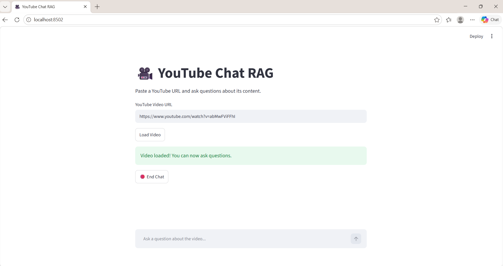
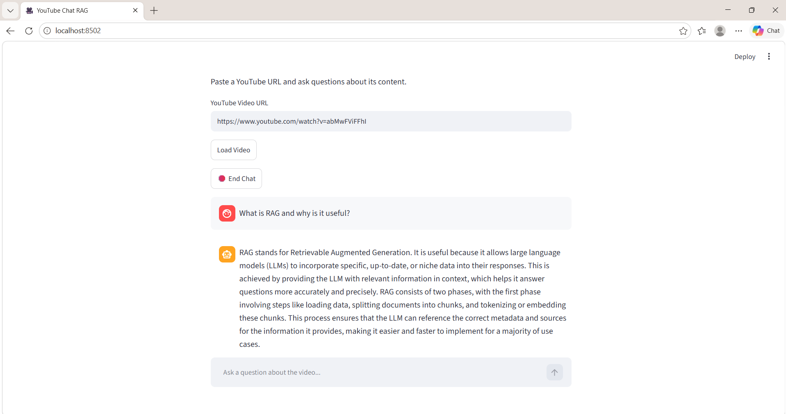

# 🎥 YouTube Chat RAG

A simple AI-powered app that lets you chat with a YouTube video. Instead of watching the entire video again to find a specific detail, you can paste its URL and ask questions about the content.

I built this project to learn how Retrieval-Augmented Generation (RAG) works and how to use LangChain to build a practical AI application.

## ✨ Features

- **YouTube Transcript Extraction** — Fetches the video's English transcript.
- **Text Splitting** — Breaks the transcript into smaller chunks for better retrieval.
- **Embeddings** — Converts text into numerical representations using OpenAI embeddings.
- **Vector Search** — Uses FAISS to find relevant information from the transcript.
- **AI-Powered Answers** — Uses an OpenAI language model to answer questions based on the retrieved context.
- **Interactive Chat UI** — Built with Streamlit, with chat history and an End Chat button.

## 🛠️ Tech Stack

- Python
- LangChain
- OpenAI API
- FAISS
- YouTube Transcript API
- Streamlit
- python-dotenv

## 📸 Screenshots

### Main Interface



### Chat Demo



## 📂 Project Structure

```text
youtube-chat-rag/
├── app/
│   ├── __init__.py
│   ├── main.py
│   ├── transcript.py
│   ├── rag_pipeline.py
│   └── ui.py
├── screenshots/
│   ├── main-ui.png
│   └── chat-demo.png
├── .env.example
├── .gitignore
├── README.md
└── requirements.txt
```

## 🚀 Getting Started

### 1. Clone the repository

```bash
git clone YOUR_GITHUB_REPOSITORY_URL
cd youtube-chat-rag
```

Replace `YOUR_GITHUB_REPOSITORY_URL` with your actual GitHub repository URL.

### 2. Create and activate a virtual environment

On Windows:

```powershell
python -m venv venv
.\venv\Scripts\Activate.ps1
```

### 3. Install dependencies

```bash
python -m pip install -r requirements.txt
```

### 4. Set up your API key

Create a `.env` file in the project root and add your OpenAI API key:

```text
OPENAI_API_KEY=your_openai_api_key
```

Keep your real API key private. Never upload your `.env` file to GitHub.

### 5. Run the application

```bash
python -m streamlit run app/ui.py
```

Open the local URL shown in your terminal, paste a YouTube video URL, load the video, and start asking questions.

## 🧠 What I Learned

While building this project, I got hands-on experience with:

- Fetching and processing YouTube transcripts.
- Splitting documents into manageable text chunks.
- Generating embeddings and storing them in a FAISS vector index.
- Retrieving relevant context for user questions.
- Connecting a retriever, prompt, and language model using LangChain.
- Building an interactive AI application with Streamlit.

## 🔮 Future Improvements

- Improve retrieval quality for more accurate answers.
- Add support for more transcript languages.
- Display relevant transcript excerpts alongside answers.
- Deploy the application so others can try it online.

---

**Built as a hands-on project while learning AI Engineering and RAG.**